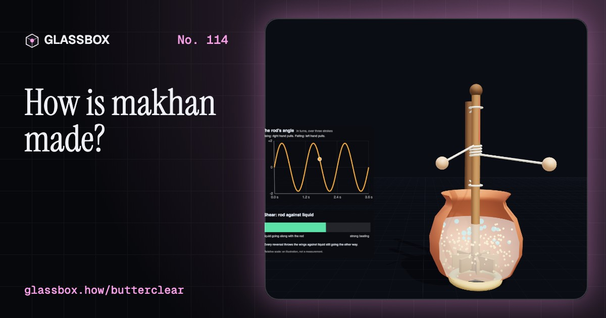
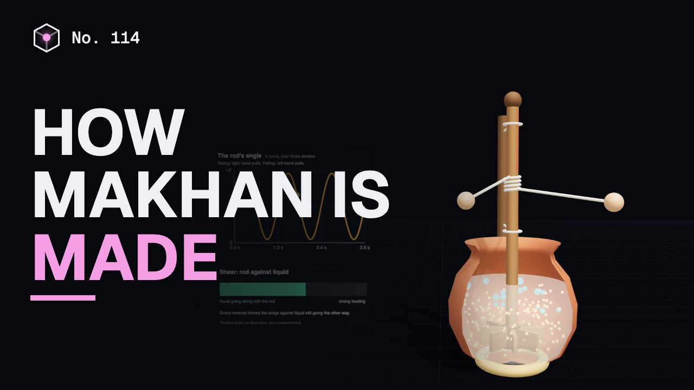
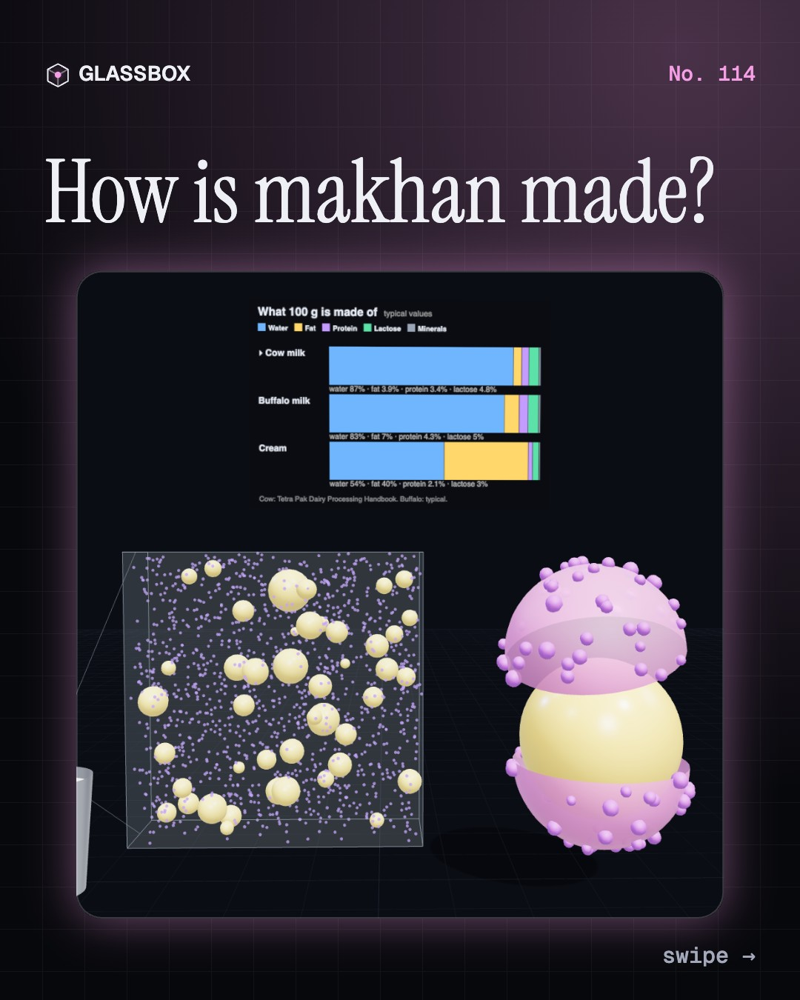
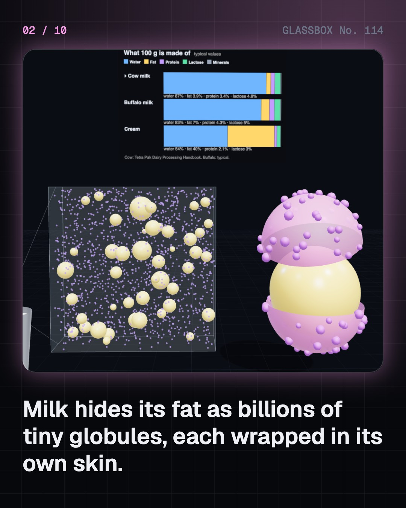
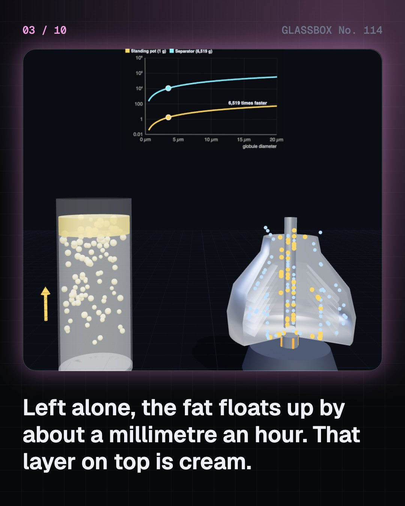
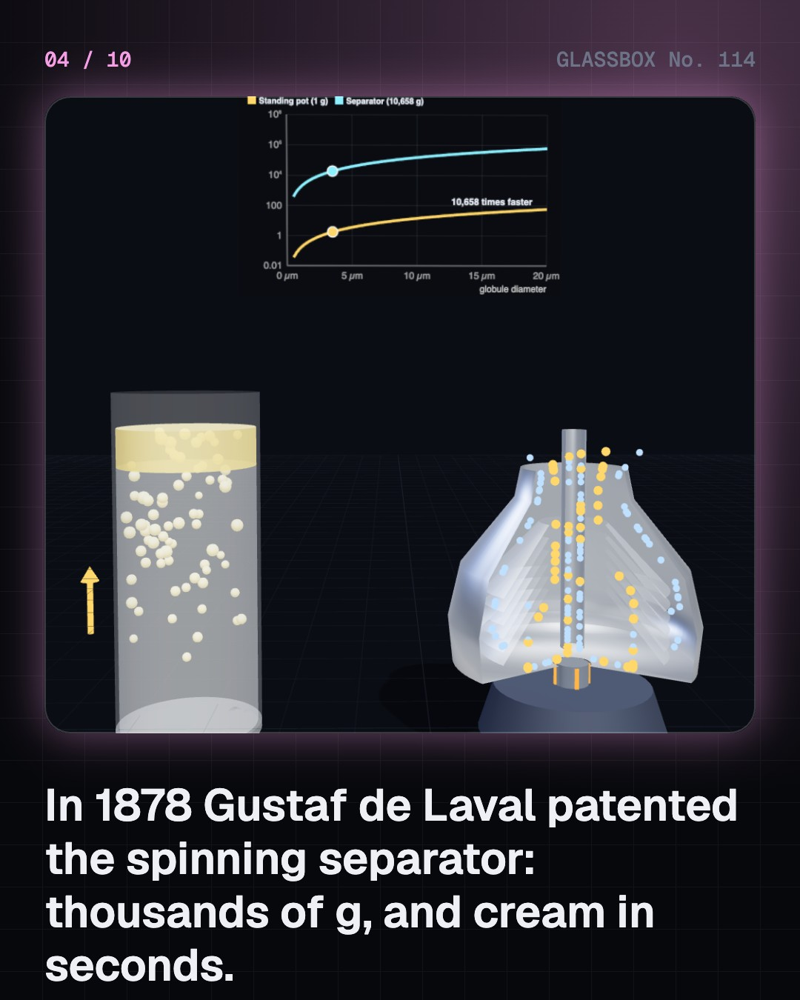

<!-- glassbox:start -->
<!-- Generated from glassbox.json by the Glassbox hub (npm run readme -- butterclear). Edit glassbox.json, not this block. -->
<p align="center"><a href="https://glassbox.how/e/butterclear/"></a></p>

<h1 align="center">ButterClear</h1>

<p align="center"><b>How is makhan made?</b><br>Makhan is not squeezed out of milk. It is milk fat turned inside out. Billions of tiny fat globules float in water, each in its own skin, until the mathani tears the skins and the fat sticks together. Churn a pot, watch the globules, and see why ice goes in on a hot day.</p>

<p align="center"><a href="https://glassbox.how/butterclear/"><b>▶ Play with it</b></a> &nbsp;·&nbsp; <a href="https://glassbox.how/e/butterclear/">Read the 60-second explainer</a> &nbsp;·&nbsp; <a href="https://glassbox.how/butterclear/glassbox/reel.mp4">Watch the 40-second video</a></p>

<p align="center">
  <a href="https://glassbox.how/e/butterclear/"></a>
  <a href="https://glassbox.how/e/butterclear/"></a>
  <a href="LICENSE"></a>
  <a href="LICENSE-CONTENT.md"></a>
  <a href="#privacy"></a>
</p>

## In 60 seconds

1. **Milk hides its fat.** Milk is about 87% water. Its fat floats in it as billions of tiny globules, 3 to 4 thousandths of a millimetre across, each wrapped in a thin membrane that stops them merging. Buffalo milk has nearly twice the fat of cow milk.
2. **Cream rises by Stokes' law.** Fat is lighter than the watery milk, so globules float up at about a millimetre an hour, and bigger ones rise much faster. A spinning cream separator, patented by Gustaf de Laval in 1878, replaces gravity with thousands of g and does the job in seconds.
3. **The churn goes back and forth.** A mathani is a rod spun by a rope: pull one end and it turns one way, pull the other and it turns back. Each reversal throws the wings against liquid still moving the other way, which beats air in and knocks globules together.
4. **The break is an emulsion flipping.** Globules crowd onto air bubbles, their skins tear, and liquid fat glues them into clumps. Suddenly fat-in-water becomes water-in-fat: butter grains in thin buttermilk. It works best at about 10 to 15 °C, which is why cold water or ice goes into the pot in summer.
5. **Wash, work, salt.** Washing removes buttermilk, and working presses the leftover water into droplets too small to see. White makhan from dahi is soft, tangy and unsalted. Table butter is salted, often coloured, and by FSSAI rules at least 80% milk fat with at most 16% moisture. The liquid left over is chaas.
6. **Hard cold, soft warm.** Milk fat is hundreds of fats with different melting points, so butter has a melting range. At fridge temperature about half the fat is crystal and the block is hard. Near 20 °C about a fifth is, and it spreads. By body temperature it has all melted.

## Words worth knowing

| Term | Meaning |
|---|---|
| **Emulsion** | Tiny droplets of one liquid spread through another it does not mix with. Milk is fat in water, and butter is water in fat. |
| **Fat globule membrane** | The skin of phospholipids and proteins, 10 to 20 nanometres thick, around every fat globule in milk. |
| **Stokes' law** | The speed of a small ball through a liquid: v = d² Δρ g ÷ 18 η. Twice the diameter means four times the speed. |
| **Mathani (bilona)** | The Indian wooden churning rod, spun back and forth by a rope wound round it. |
| **Partial coalescence** | Fat globules sticking together without fully merging: liquid fat is the glue and fat crystals keep the shape. |
| **Phase inversion** | An emulsion turning inside out, as when cream (fat in water) becomes butter (water in fat). |
| **Chaas (buttermilk)** | The thin liquid left after churning: water, protein, lactose and a little fat. |
| **Melting range** | The span of temperatures over which a mixture of fats goes from solid to liquid. For milk fat it is roughly −40 °C to +40 °C. |

## A short history

**From fat left in a clay pot nine thousand years ago to the white makhan in an Indian kitchen and the yellow block on the breakfast table.**

- **4200 BCE** · A clay churn you rock like a cradle (Potters of the Ghassulian and Beersheba cultures, Bir Abu Matar, near Beersheba, southern Levant)
- **2500 BCE** · Dairy fat in Indus valley pots (People of the Indus civilisation; studied by Kalyan Sekhar Chakraborty and colleagues, Kotada Bhadli, Kutch, Gujarat)
- **900** · Krishna, the makhan chor (The tradition of the Bhagavata Purana, Gokul and Vrindavan, in the Braj country)
- **1674** · Globules in milk (Antonie van Leeuwenhoek, Delft, Dutch Republic)
- **1878** · Cream in seconds: the centrifugal separator (Gustaf de Laval, Stockholm, Sweden)
- **1941** · Butter without stopping: the Fritz process (Dr Fritz (Willi Fritz in his patents, often written Wilhelm Fritz), Germany)
- **1946** · The farmers of Kaira start their own union (Tribhuvandas Patel, with the backing of Sardar Vallabhbhai Patel and Morarji Desai, Anand, Kaira district, Gujarat)
- **1955** · Buffalo milk powder, and a name: Amul (Verghese Kurien, H. M. Dalaya and Tribhuvandas Patel, Anand, Gujarat)

The full story, with 27 moments, charts, people and 55 sources: [glassbox.how/e/butterclear/history](https://glassbox.how/e/butterclear/history/). The data lives in [`history.json`](history.json).

## Video and slides

Made with the Glassbox studio from this box's storyboard (`window.glassbox.director`). Free to reuse under CC BY 4.0.

<a href="https://glassbox.how/butterclear/glassbox/video.mp4"></a>

<p><a href="glassbox/slide-1.jpg"></a> <a href="glassbox/slide-2.jpg"></a> <a href="glassbox/slide-3.jpg"></a> <a href="glassbox/slide-4.jpg"></a></p>

| File | What | Size |
|---|---|---|
| [`glassbox/reel.mp4`](https://glassbox.how/butterclear/glassbox/reel.mp4) | Reel / Short, with captions and soundtrack | 1080×1920 |
| [`glassbox/video.mp4`](https://glassbox.how/butterclear/glassbox/video.mp4) | YouTube video, with captions and soundtrack | 1920×1080 |
| `glassbox/slide-1…10.jpg` | Instagram carousel | 1080×1350 |
| `glassbox/thumb.jpg` | YouTube thumbnail | 1280×720 |
| `glassbox/cover.jpg` | Share card and repo social preview | 1200×630 |
| [`glassbox/history-reel.mp4`](https://glassbox.how/butterclear/glassbox/history-reel.mp4) | “History in 10 moments” Reel / Short | 1080×1920 |
| `glassbox/history-slide-*.jpg` | History carousel | 1080×1350 |
| `glassbox/post.json` | Post copy and schedule used by the publish kit | |

## Privacy

This box has no accounts and no ads, and it ships its own fonts and libraries. When you run it yourself it sends nothing anywhere. On glassbox.how, the site's `/bar.js` also loads Glassbox's analytics: **Google Analytics** to count visits (it asks first in the EU, UK and Switzerland, and stays off when your browser sends Global Privacy Control or Do Not Track) and **ClickTrust** to detect bots.

It remembers a few things **in your own browser only**, and never sends them anywhere:

| Browser storage key | What it holds |
|---|---|
| `butterclear.v1` | Which chapters you have opened, your best quiz scores, and sound on or off. |

Exactly what each one sees is at [glassbox.how/privacy](https://glassbox.how/privacy/).

## Licences

- **Code:** [MIT](LICENSE). Use it, change it, ship it.
- **Explanations, text, images and videos** (`glassbox.json`, `glassbox/`): [CC BY 4.0](LICENSE-CONTENT.md). Credit “Glassbox, glassbox.how/e/butterclear”.
- **Third-party parts** keep their own licences: [three.js](https://threejs.org) (MIT), [Geist, Instrument Serif](https://openfontlicense.org) (SIL OFL 1.1).
- The Glassbox name and logo aren't covered by either licence. See the [terms](https://glassbox.how/terms/).

Found a mistake? [Open an issue](https://github.com/bdeeps/butterclear/issues). Corrections happen in public.
<!-- glassbox:end -->

## Run it

It's plain HTML, CSS and JavaScript. No build step and no dependencies. Run locally, it contacts no other website.

```bash
python3 -m http.server 8000
```

Three.js and the fonts ship in `vendor/` and `fonts/`, so it also works offline.

Then open http://localhost:8000.

## How it's built

| File | What |
|---|---|
| `index.html`, `css/app.css` | The page and its styles |
| `js/app.js`, `js/stage.js`, `js/ui.js`, `js/kit.js` | The shared Glassbox 3D engine: chapters, 3D stage, controls, quiz, video director |
| `js/chapters/*.js` | One file per chapter: the 3D model, controls, text, key terms, quiz and video scenes |
| `js/butter.js` | Shared numbers and parts: milk composition, Stokes' law, the solid fat curve, the churning model, FSSAI limits, chart boards, and the 3D matka and mathani |
| `glassbox.json` | Title, question, explainer beats, key terms, browser storage and credits shown on glassbox.how |
| `reel` in each chapter | The storyboard the Glassbox studio records into short videos |
| `glassbox/` | The published video, slides, thumbnail and post copy |
| `fonts/`, `vendor/three/` | Self-hosted Geist and Instrument Serif (SIL OFL 1.1) and three.js (MIT) |
